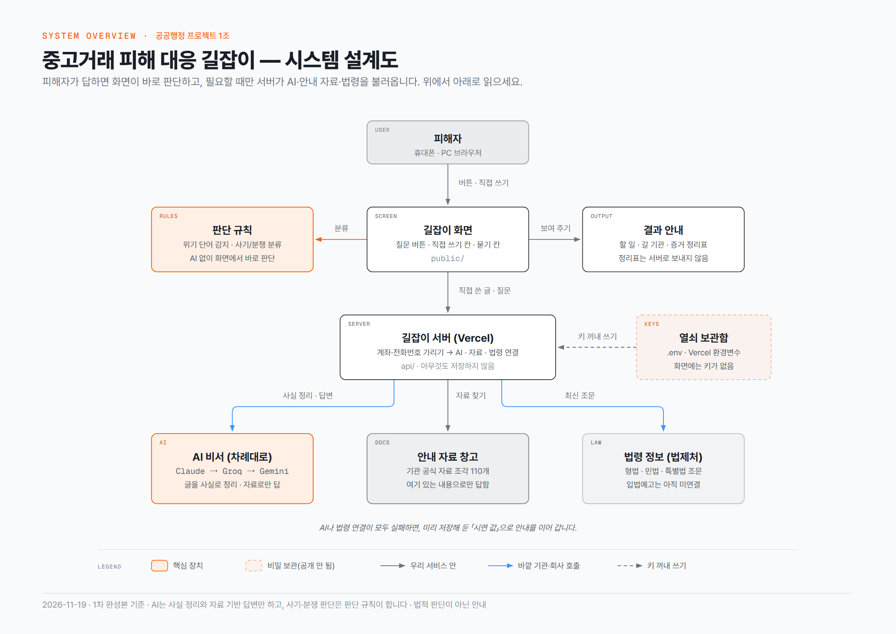

# 중고거래 피해 대응 길잡이

> 공공행정 프로젝트 1조 시제품 — **실제 온라인피해 365센터 서비스가 아닙니다.**

중고거래에서 피해를 입은 사람이 **"어디에 먼저 가야 하는지"** 를 바로 알 수 있게 돕는 웹 서비스입니다.
방송미디어통신위원회 온라인피해 365센터의 상담 중 **첫 분류와 기관 안내**를 앞에서 맡는 도구로 제안합니다.

## 무엇을 하나요

1. **안전 확인** — "죽고 싶다" 같은 위기 표현이 보이면 가장 먼저 자살예방 상담전화 ☎109를 안내합니다.
2. **상황 진단** — 버튼으로 답하거나 있었던 일을 그대로 적으면, 사실(송금 방법·물건 수령·연락 상태 등)로 정리합니다.
3. **분류** — 정해 둔 판단 규칙으로 **사기 의심 · 거래 분쟁 · 범위 밖(착오송금·보이스피싱) · 판단 어려움**을 가립니다.
4. **안내** — 지금 할 일, 갈 기관(경찰청 ECRM, 분쟁조정위원회, 대한법률구조공단 등), 판매자에게 보낼 메시지 초안을 보여 줍니다.
5. **증거 정리표** — 기관에 낼 정리표를 항상 같은 양식으로 만들어 내려받게 합니다.
6. **더 궁금한 점 묻기** — 기관 공식 안내 자료에 있는 내용으로만 답하고, 근거 문서 이름을 붙입니다.

**하지 않는 일:** 사기 여부 확정, 배상 금액 안내, 피해금 회수, 기관에 사건 자동 접수. 모든 결과는 *법적 판단이 아닌 안내*입니다.

## 시스템 설계도



[PDF로 보기](docs/설계도/시스템설계도.pdf)

- **판단은 규칙이, AI는 정리만** 합니다. 사기·분쟁 분류는 화면 안의 판단 규칙이 AI 없이 하고, AI는 직접 쓴 글을 사실로 정리하거나 안내 자료로만 답합니다.
- **AI는 차례대로** 부릅니다: Claude → Groq → Gemini. 앞이 실패하면 다음으로 넘어가고, 모두 실패하면 미리 저장한 「시연 값」으로 안내를 이어 갑니다.
- **아무것도 저장하지 않습니다.** 증거 정리표는 서버로 보내지 않고, AI에 보내는 글의 계좌·전화번호는 가립니다.

## 폴더

| 폴더 | 내용 |
|---|---|
| `public/` | 이용자가 보는 화면 |
| `api/` | 서버 — AI · 안내 자료 · 법령 연결 |
| `docs/답변참고문서/청킹/` | AI가 답할 때 쓰는 기관 공식 자료 조각(110개) |
| `docs/설계도/` | 시스템 설계도 |

## 로컬에서 실행하기

`.env` 에 키를 넣은 뒤(키는 깃허브에 올리지 않습니다):

```bash
npm install
npm run dev
```

브라우저에서 `http://localhost:3000` 을 엽니다.

필요한 키 이름: `CLAUDE_API_KEY`, `GROQ_API_KEY`, `GEMINI_API_KEY`(이름마다 키 하나), `LAW_OC`, `LAWMAKING_OC`
